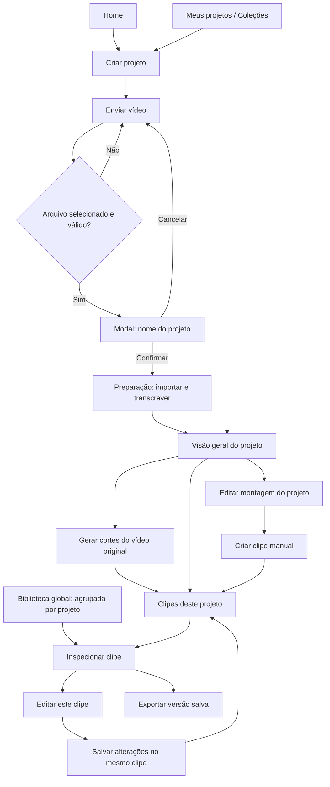
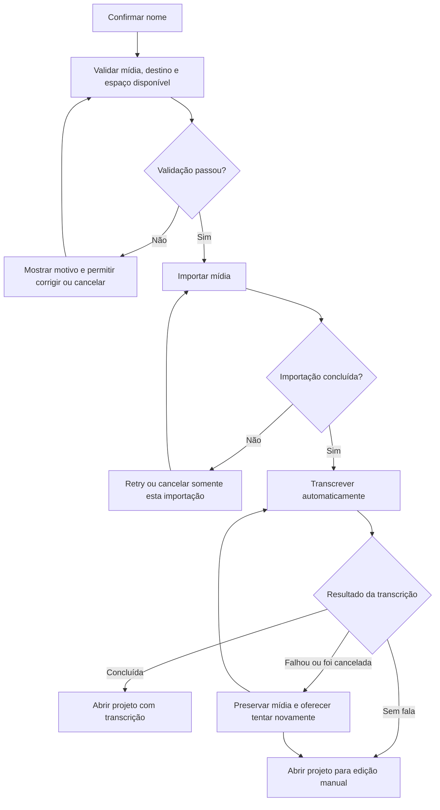
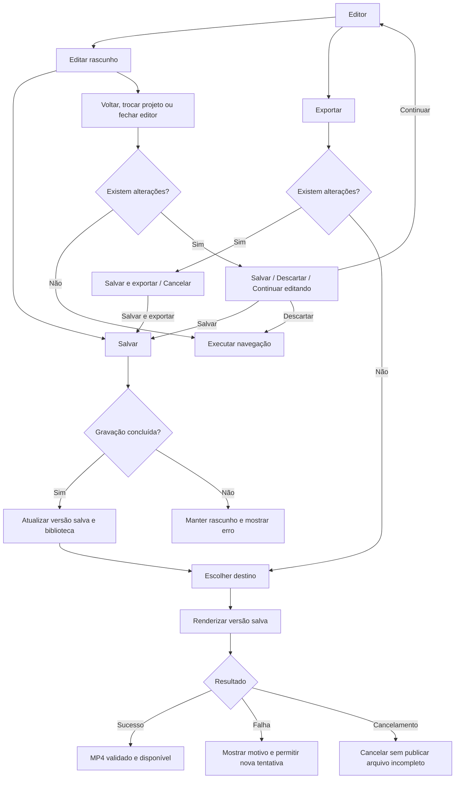

# Editor básico completo e fluxo de projetos do CutNicePro

## 1. Objetivo e decisões que governam a entrega

Entregar um fluxo compreensível do envio à exportação, com um editor que permita **montar, aparar, dividir, remover, duplicar e combinar vídeos, imagens e áudio**, preservando as funções existentes de legenda.

O caminho principal será:

**Enviar vídeo → nomear projeto → importar e transcrever → abrir projeto → editar ou gerar cortes → revisar → salvar → exportar.**

Fila de refinamento autorizada em2026-10-26: miniaturas de imagem e seleção de itens curtos no zoom distante; biblioteca sem aprovação/rejeição, lixeira com restauração e exclusão permanente após7dias; importação para a abaMídia separada da inserção na timeline, incluindo arraste do Windows; tempo/Novo após salvar edição manual. Os botões+ de início/fim foram confirmados pelo mantenedor, com essas falhas adicionais registradas. Ao concluir esta fila e publicar os commits autorizados, pausar a meta a pedido do mantenedor; não marcar o editor integral como concluído. Permanecem as lacunas de desempenho com797MB, jornada nativa normal, prévia de imagens grandes e partes não comprovadas deM6.

As decisões já definidas são:

- Arrastar e editar altera um **rascunho**. O botão **Salvar** confirma as alterações.
- Editar um corte da IA atualiza **o mesmo corte**. Após salvar uma alteração, ele fica identificado como **Editado manualmente**, sem nota de ranking.
- Salvar a montagem do projeto e **Criar clipe** são ações diferentes.
- Excluir na faixa principal fecha o espaço por padrão. O menu oferece também **Excluir mantendo espaço**.
- Imagens, legendas e áudios associados acompanham a edição. É possível fixar um elemento no tempo.
- Uma montagem pode conter somente imagens e áudio. Também pode ficar vazia durante a edição.
- Uma falha na transcrição preserva o projeto e permite editar manualmente.
- A correção de legenda dentro de um clipe pertence àquele clipe.
- A geração por IA continua analisando o **vídeo original**, independentemente da montagem manual.
- Recuperação de rascunho nunca substitui silenciosamente uma versão salva.

Esta entrega não acrescenta filtros, plugins, stickers, download do YouTube ou novas calibrações do modelo.

## 2. Mapa completo da jornada

### Navegação principal

**Regras de navegação:**

- Criar projeto pela Home, por Meus projetos ou por uma coleção usa o mesmo fluxo.
- O envio não pula diretamente para um editor vazio de transcrição.
- Abrir um clipe pela biblioteca preserva essa origem. Voltar retorna à biblioteca e mantém projeto, filtros e posição de rolagem.
- Abrir pelo projeto retorna aos clipes daquele projeto.
- Salvar não muda de tela automaticamente.
- Um job concluído em segundo plano informa o resultado e oferece **Abrir projeto**. Não interrompe outra edição nem troca a tela sozinho.
- Projetos, clipes e montagens usam identificadores estáveis. Uma falha não pode produzir uma “biblioteca oculta” ou um clipe sem projeto acessível.

### Envio e preparação

O modal mostrará etapas reais:

1. Validando arquivo.
2. Importando vídeo.
3. Preparando áudio.
4. Transcrevendo.
5. Preparando projeto.

O progresso será determinado pelo trabalho executado. A estimativa de tempo aparece quando houver dados suficientes; antes disso, mostra **Calculando estimativa**. Não haverá percentual artificial para aparentar atividade.

| Situação | Comportamento definido |
|---|---|
| Cancelar o nome do projeto | Volta ao envio, mantendo o arquivo selecionado; nenhum projeto é criado. |
| Nome vazio | Confirmação desabilitada com orientação no próprio campo. |
| Arquivo inválido | Mostra o motivo e permite trocar o arquivo. |
| Mesmo arquivo já importado | Pode criar outro projeto reutilizando a mídia gerenciada; não precisa copiar novamente. |
| Cancelar durante a cópia | Remove somente os temporários e o projeto incompleto dessa operação. |
| Cancelar durante a transcrição | Mantém projeto e vídeo importado. Pode editar ou retomar a transcrição. |
| Modelo de transcrição indisponível | Explica o impedimento; permite edição manual e acesso à configuração existente. |
| Vídeo sem áudio ou sem fala | Abre normalmente para edição; geração textual fica indisponível com motivo visível. |
| Falha após a importação | Não apaga o vídeo já importado nem exige repetir a cópia. |
| Aplicativo fechado durante o processamento | Ao reabrir, mostra a operação interrompida e oferece recuperação ou nova tentativa segura. |

A transcrição concluída será persistida como resultado do processamento. Isso **não equivale a salvar alterações feitas na montagem**.

### Edição, saída e exportação

No caminho **Salvar e sair**, a navegação só acontece após a confirmação da gravação. Se salvar falhar, o editor permanece aberto com o trabalho preservado.

## 3. Organização dos controles na interface

A interface continuará usando a identidade, os componentes e os ícones do projeto.

| Região | Conteúdo e comportamento |
|---|---|
| **Cabeçalho** | Voltar, caminho do projeto/clipe, nome, estado de alterações, Desfazer, Refazer, **Salvar** e **Exportar**. Salvar terá texto e ícone, não apenas um símbolo sem explicação. |
| **Painel esquerdo** | Abas **Mídia** e **Transcrição**. Mídia mostra arquivos do projeto e permite adicionar vídeo, imagem e áudio. |
| **Visualização da fonte** | Ao abrir uma mídia, substitui temporariamente a prévia central para assistir ao original e marcar o trecho que será inserido. Identificação explícita **Fonte**, com retorno à montagem; não mantém um segundo reprodutor permanente na biblioteca. |
| **Prévia central** | Mostra o resultado da montagem. Controles de transformação aparecem somente para o elemento selecionado. |
| **Painel direito** | Propriedades do item selecionado, Legendas, Enquadramento e Áudio. Sem seleção, mostra propriedades da montagem. Biblioteca e propriedades permitem expandir, redimensionar, recolher e reabrir; ações de geração/exportação do projeto não pertencem à transcrição. |
| **Timeline inferior** | Área redimensionável com régua, itens reais, miniaturas, ondas de áudio, legendas, seleção e cursor. |

### Timeline

A timeline passa a representar **o vídeo que será exportado**, começando em `00:00`.

- A faixa principal contém os vídeos e imagens em sequência.
- Faixas superiores permitem imagens e vídeos sobrepostos.
- O áudio original acompanha o vídeo e sua onda aparece no mesmo item por padrão. Áudio importado ou extraído explicitamente ocupa faixa própria. Documentos antigos continuam legíveis; vínculos ambíguos não são ocultados.
- Legendas permanecem vinculadas aos trechos correspondentes.
- Na timeline, legendas vinculadas à fonte aparecem como uma pequena tag **CC** no próprio vídeo, preservando itens, tempos e correções no documento. Legendas independentes, fixas, bloqueadas ou de vínculo ambíguo continuam acessíveis em faixa própria. Duplicar o vídeo não cria uma faixa de legenda que bloqueie sua seleção.
- Cada item tem miniaturas dentro dos seus limites e alças visíveis nas duas extremidades.
- Seleção, alças, régua, ondas e cursor usam a mesma escala e o mesmo deslocamento horizontal.
- O cursor atravessa todas as faixas. Não haverá uma barra de corte visualmente separada da miniatura.
- Zoom preserva o ponto observado. Haverá **Ajustar montagem à largura**.
- O scroll horizontal move todas as faixas em conjunto.
- Faixas possuem identificação e controles pertinentes de visibilidade, áudio e bloqueio.

A barra de ferramentas da timeline terá:

- Seleção, com variação para selecionar intervalo.
- Dividir, com menu de variações.
- Excluir, com opções de fechar ou manter espaço.
- Adicionar, com vídeo, imagem, áudio ou trecho de uma fonte.
- Criar clipe a partir do intervalo marcado.
- Controles de reprodução e tempo.
- Zoom e ajuste à largura.

Os botões `+` nas extremidades da faixa principal abrem o mesmo menu **Adicionar**, indicando inserção no início ou no fim.

Fatia implementada no Complemento18: a intenção acompanha cada operação/importação/Fonte, sem mover o cursor. Fim considera somente itens da principal; áudio/CC/sobreposições posteriores não mudam esse destino. Cancelar o seletor/fechar Fonte não altera o pedido seguinte. Controles compartilham espaço lateral com a régua/itens/cursor e respeitam bloqueio/gestos/recuperação. Testes de domínio/React e build aprovados no escopo descrito; experiência da build normal permanece no aceite humano.

### Consistência e acessibilidade

- Menus de contexto com ícone, texto, atalho e estado desabilitado.
- Tooltips, seletores, confirmações e mensagens usando componentes do projeto.
- Nada de `alert`, `confirm`, `prompt`, tooltip nativo por `title` ou controles visuais padrão do navegador.
- Seletores nativos do sistema continuam apropriados para escolher arquivos e destino de exportação.
- Scrollbars seguem o padrão visual do aplicativo.
- Menus funcionam por teclado, fecham com Escape e devolvem o foco ao controle de origem.
- Refinamento de 2026-10-26: compactar os ajustes de Enquadramento no próprio painel, com ícones referenciais/tooltips e campos precisos de posição/zoom. Após teste humano, corrigir o estado ativo para branco com texto/ícone preto e inativo discreto escuro; fundo usa o mesmo seletor circular+hex de Legendas, sem caixa aninhada. Posição/zoom têm controles visíveis de diminuir/aumentar com mouse, respeitando limites e faixa bloqueada; digitação e teclado continuam opcionais. Rascunho seguido de clique não aplica duas alterações nem usa valor antigo. Essa fatia não adiciona controles de transformação sobre o canvas/prévia; preserva os contratos, a detecção de pessoas e o ajuste de cada painel.
- Pedido posterior explícito do mantenedor na mesma revisão: a mídia selecionada precisa da caixa e alças de seleção da referência para mover/redimensionar, inclusive na faixa principal. Isso refina a restrição anterior: não adicionar painéis ou botões soltos na prévia; a caixa/alças da seleção está autorizada. Pan deve seguir o gesto em contain e cover, distinguindo deslocamento da camada de deslocamento do recorte; preservar pixels/contrato da exportação, limites, lock e uma confirmação por gesto. Cancelar/Escape ou desmontar durante o gesto não deixa prévia pendente nem salva automaticamente.
- Fila adicional da mesma revisão: todos os modais do aplicativo devem distinguir ação principal de secundária, sem dois botões de igual destaque para confirmar/cancelar. Criar clipe usa tempos legíveis e editáveis, título igual à ação que o abriu e texto orientado ao resultado, conforme a skill cutnicepro-ux-writing. Não mudar efeitos de cancelamento, recuperação, confirmação de exclusão ou salvamento por consequência da revisão visual.
- Botões mantêm respiro, área clicável e foco visível por teclado.
- Em janelas menores, painéis laterais recolhem em abas; ações essenciais e timeline continuam acessíveis.

O desenho definitivo deverá mostrar também estados vazio, carregando, erro, seleção, arrasto e alterações pendentes. A aprovação visual continuará sendo sua.

## 4. Funcionamento das operações de edição

### Fonte e montagem são tempos diferentes

Refinamento autorizado em 2026-10-27 (JRN-009, BR-EDITOR-02/03, AC-EDITOR-02/03): **Escolher trecho da fonte** usa uma faixa de miniaturas do arquivo original, com seleção por arraste como a ferramenta R e alças para ajustar os dois limites. O slider isolado e as ações empilhadas são substituídos por essa seleção visual e uma barra única. Marcar não altera a montagem; Enter ou Adicionar confirma uma vez e insere em **nova camada**, no cursor ou no destino início/fim que abriu a operação, sem deslocar nem aparar os itens existentes. Salvar continua explícito; áudio e CC acompanham o vídeo pelos vínculos atuais. Adição rápida da biblioteca e importação mantêm seus contratos anteriores.

Plano desta fatia, sem retomar a pesquisa/goal integral pausado:

- [x] Separar o espaço clicável dos marcadores compactos e dos botões+ nas extremidades, mantendo escala temporal, cursor e dados; teste de colisão com um frame e uma cauda longa.
- [x] Reutilizar as miniaturas já carregadas, preparando também a fonte escolhida ainda ausente da montagem; nenhuma decodificação por movimento do mouse.
- [x] Implementar seleção nos dois sentidos, ajustes de início/fim, duração mínima de um frame, teclado I/O/Enter/Espaço e cancelamento por Escape/blur/pointercancel. Desmontar limpa o gesto, sem inserção tardia.
- [x] Usar `overlayComposition` somente na confirmação do viewer Fonte; preservar originais, grupos, camadas e cursor, inclusive com principal bloqueada. Testar Undo/Redo/Save e destino atual.
- [x] Validar os consumidores alterados, lint e build padrão; entregar roteiro manual. UI/gestos no aplicativo normal e aprovação visual continuam com o mantenedor.

Feedback adicional de zoom: trechos isolados de1/2frames faziam o mínimo superar o teto20px/frame; fit inicial/expresso também extrapolava esse teto. Limites agora são compartilhados por fit/reveal/controles e revalidados após duração/resize. Durante arraste a escala fica estável; normalização automática só após soltar/cancelar, sem consumir o primeiro ajuste à largura. Regressões cobrem também60fps, montagem vazia, troca para duração longa, marcadores compactos, botões, slider e Ctrl+roda. Validação final da fatia:161/161 testes em20arquivos, lint focal sem avisos, tsc/Vite e cargo build padrão aprovados. Isso não substitui o reteste humano nem encerra as pendências integrais do editor.

Um trecho original de `03:00–03:30` pode aparecer em `00:00–00:30` da montagem. O mesmo trecho pode ser duplicado e aparecer novamente depois.

Essa separação permite:

- Mudar a ordem.
- Repetir um trecho.
- Inserir outras mídias.
- Remover uma parte sem alterar o original.
- Estender um corte da IA para antes ou depois do intervalo inicialmente escolhido.

O plano atual de intervalos ordenados da fonte não será usado como se já suportasse essas operações.

### Operações principais

| Ação | Resultado definido |
|---|---|
| Arrastar a alça inicial | Altera a entrada do trecho na fonte sem deslocar o cursor de reprodução. |
| Arrastar a alça final | Altera a saída do trecho sem deslocar o cursor, inclusive se o novo fim ficar antes dele. |
| Estender o primeiro item para trás | Recupera conteúdo anterior da fonte; a montagem continua começando em zero. |
| Dividir no cursor | Separa os itens selecionados que atravessam o cursor. Não altera duração nem cria uma interface adicional de “corte”. |
| Excluir à esquerda/direita do cursor | Q/W removem a parte correspondente somente dos vídeos/imagens explicitamente selecionados e seus vínculos. Preservam espaços e demais camadas; cursor fora do item ou nas extremidades não apaga o trecho inteiro. |
| Selecionar intervalo | Marca uma região da montagem para copiar, remover, separar ou transformar em clipe. |
| Remover intervalo | Retira aquela região, preservando os trechos dos dois lados. |
| Duplicar | Cria outra instância editável em camada acima, no mesmo instante, reutilizando o arquivo original. |
| Reordenar na faixa principal | Move o bloco para o ponto indicado, com prévia da posição de inserção. |
| Adicionar vídeo | Importa ou reutiliza a mídia e insere o intervalo escolhido. |
| Adicionar imagem | Insere inicialmente por cinco segundos, com duração ajustável. |
| Adicionar áudio | Insere no cursor em faixa de áudio, permitindo aparar, mover, duplicar e ajustar volume. |
| Sobrepor imagem ou vídeo | Insere em faixa visual superior; posição, escala e duração ficam editáveis. |
| Desvincular áudio | Permite editar o áudio separadamente do vídeo. |
| Criar clipe manual | Salva um novo clipe no projeto a partir do intervalo escolhido da montagem. |

**Limites de arrasto:** nenhuma alça ultrapassa o conteúdo disponível na fonte, inverte o trecho ou cria duração inferior a um frame. Ao atingir o limite, a interface informa o motivo.

Durante um arrasto, a prévia acompanha a alteração. Ao soltar, entra **uma única ação** no histórico. Escape cancela o gesto inteiro.

### Fechamento de espaços e sincronismo

A exclusão na faixa principal remove o intervalo e desloca o conteúdo posterior.

Nas faixas que acompanham a montagem:

- Conteúdo anterior permanece.
- Conteúdo posterior acompanha o deslocamento.
- Um elemento inteiramente dentro da região removida também é removido.
- Um elemento que atravessa a região é aparado ou dividido, preservando as partes restantes.
- Áudio e legendas da fonte seguem o mesmo recorte.

Elementos definidos como **Fixos na linha do tempo** mantêm sua posição. Essa escolha fica no menu do elemento.

Inserir material no meio abre espaço para o novo trecho. Elementos sincronizados que atravessam o ponto são separados para não aparecerem indevidamente sobre a nova cena.

Uma operação que alteraria uma faixa bloqueada será impedida com explicação. O aplicativo não desbloqueia nem perde sincronismo silenciosamente.

### Seleção, cópia e colagem

- Clique seleciona um item.
- Ctrl+clique adiciona ou remove itens da seleção.
- Shift+clique amplia a seleção.
- O modo **Intervalo** permite selecionar parte de um ou mais itens.
- Copiar um intervalo leva somente o conteúdo selecionado, mantendo seus vínculos.
- Ctrl+V cola no cursor em uma camada acima, sem deslocar os itens existentes. **Colar em sequência**, no menu ou Ctrl+Shift+V, insere explicitamente na sequência.
- Duplicações recebem identificadores próprios; editar uma não altera a outra.
- Colagem entre projetos registra as referências de mídia necessárias sem duplicar arquivos desnecessariamente.

### Posicionamento livre e ímã da faixa principal — refinamento de 2026-10-26

- O estado do ímã (P) é uma preferência da sessão. Desligá-lo permite deixar espaços antes/entre os trechos e posicioná-los no tempo sem compactar a faixa. Conforme o teste manual posterior, **religá-lo reencaixa a faixa principal no início**: esse reposicionamento é uma edição do rascunho, com Undo e Save explícito, preservando fonte, IDs e vínculos. Uma faixa bloqueada não é desbloqueada silenciosamente.
- Com o ímã ligado, arrastar na faixa principal reordena blocos inteiros. O gesto não recorta e reinsere cópias nem fragmenta legendas longas sem necessidade.
- A alça esquerda avança a entrada e a posição inicial, mantendo o fim fixo. Se o primeiro vídeo já estiver em zero e recuperar conteúdo anterior da fonte, o início permanece em zero e a duração cresce; essa exceção respeita a fonte e os vizinhos.
- Arrastar verticalmente move o mesmo item para uma faixa compatível ou cria uma camada visual acima. A identidade da camada permanece estável durante as prévias; apenas soltar confirma uma operação de histórico.
- Vídeos sobrepostos ocupam faixas distintas. Em uma mesma faixa, o destino é limitado ao espaço livre; não se salva uma sobreposição inválida nem se remove a validação para ocultar o erro.
- Camadas visuais aparecem de cima para baixo conforme sua ordem de composição; a faixa principal fica abaixo delas. A ordem visual das linhas não altera o documento salvo.
- Zoom, slider e ajuste à largura ficam agrupados à direita na mesma barra das ações, com o conteúdo largo restrito ao scroll interno da timeline. Ctrl + roda do mouse ajusta o zoom em torno do ponto sob o ponteiro, sem aplicar zoom do navegador; roda sem Ctrl continua normal. O relógio abre o ajuste preciso em um popover do design system.
- A visão mais afastada mostra até 16 vezes a duração da montagem, mantendo um limite real de afastamento. Roda, teclado, slider e botões compartilham limites; Ajustar à largura continua mostrando a montagem inteira. Essa faixa mais ampla substitui o primeiro limite demasiado restritivo identificado pelo mantenedor.

### Atalhos

Os atalhos só atuam quando o editor tem foco e o usuário não está digitando em um campo.

| Atalho | Ação |
|---|---|
| Espaço | Reproduzir/pausar |
| V | Selecionar itens |
| R | Selecionar intervalo |
| I / O | Marcar início/fim no visualizador com foco, identificado como Fonte ou Montagem |
| Ctrl+B | Dividir os itens selecionados no cursor |
| Q / W | Excluir à esquerda / direita do cursor nos visuais selecionados |
| Delete | Excluir; na faixa principal, fechar espaço |
| Shift+Delete | Excluir mantendo espaço |
| Ctrl+D | Duplicar seleção em camada acima, no mesmo instante |
| Ctrl+C / X / V | Copiar, recortar e colar |
| Ctrl+Shift+V | Colar em sequência |
| P | Ativar/desativar ímã da faixa principal |
| Ctrl+Z | Desfazer |
| Ctrl+Shift+Z ou Ctrl+Y | Refazer |
| Ctrl+S | Salvar |
| Setas esquerda/direita | Avançar ou voltar um frame quando a timeline tem foco |
| `+` / `−` | Ajustar zoom |
| Ctrl + roda do mouse | Ajustar zoom da timeline em torno do ponteiro |
| Escape | Cancelar gesto ou fechar o menu ativo |

### Legendas e enquadramento

- Presets, estilos, destaque por palavra e demais opções existentes permanecem.
- Dividir, duplicar e mover vídeo também remapeia suas legendas.
- A legenda vinculada é composta dentro da camada de seu vídeo, antes de aplicar posição, escala e opacidade; uma camada opaca acima cobre ambos. Transparência e sobreposição parcial seguem a composição real, sem apagar o texto salvo. Legendas independentes continuam acima da montagem. Ocultar a faixa do vídeo não deixa sua legenda vinculada vazar.
- Na aba Transcrição, selecionar uma ocorrência troca o contexto de texto, busca e correção para essa ocorrência; sem seleção, acompanha o vídeo ativo superior. Tempos clicados são da montagem e correções permanecem locais. Seleção não modifica a composição exportada.
- Cada instância pode ter correções locais de texto.
- Transcrição concluída durante uma edição não substitui correções nem confirma a montagem.
- Para adicionar novas legendas após uma transcrição tardia, aparece **Aplicar legendas à montagem**, como ação editável e reversível.
- Correção da transcrição original continua sendo uma ação explícita no projeto.

No enquadramento, formato da montagem e ajuste do item ficam separados. **Preencher** continua sendo uma escolha efetiva, respeitada na prévia e na exportação.

O split-screen permite ajustar manualmente as duas regiões. A detecção facial ajuda a posicioná-las; uma detecção inconclusiva não impede o usuário de configurar duas pessoas visíveis. Falhas de detecção aparecem como estado explicado, sem trocar silenciosamente a composição escolhida.

## 5. Salvamento, biblioteca e tratamento dos “e se”

### Salvamento explícito

O editor terá três estados distintos:

1. **Versão salva:** usada pela biblioteca e pela exportação.
2. **Rascunho em edição:** alterações ainda não confirmadas.
3. **Recuperação:** cópia temporária para recuperar trabalho após interrupção.

O botão Salvar:

- Fica habilitado quando existe alteração.
- Mostra estado de gravação.
- Só informa sucesso após confirmação da persistência.
- Mantém o rascunho se falhar.
- Não altera o ponto de reprodução nem navega sozinho.

Salvar um corte da IA mantém seu identificador e projeto. Após alteração efetiva, remove a nota corrente. Na biblioteca, a tag **Editado** ocupa a mesma linha e altura reservada à nota; a inspeção pode explicar que a edição foi manual. Salvar sem mudanças não altera sua classificação. Títulos dos cards ocupam até duas linhas, com reticências no excedente e texto completo no tooltip do projeto; as ações usam ícones com nomes acessíveis e tooltips próprios.

### Criar clipe manual

A ação usa o intervalo marcado na **montagem**, incluindo vídeos, imagens, áudio e legendas que o atravessam.

- Abre confirmação com nome e duração.
- Salva somente o novo clipe.
- Não salva implicitamente alterações da montagem do projeto.
- Mantém o editor aberto e confirma a criação com o nome salvo. Conforme escolha expressa do mantenedor em2026-10-26, oferece **Ir para clipes**, sem abrir outro player nem navegar automaticamente. Se a montagem do projeto estiver alterada, esse atalho respeita Salvar, Descartar ou Continuar editando; uma falha de gravação impede a saída e preserva o rascunho e o novo clipe já criado.
- O novo clipe aparece no projeto correto e na biblioteca global, sem nota.
- Na biblioteca global, cada cabeçalho de projeto permite recolher/expandir somente os próprios cards. Nome/contagem permanecem visíveis; conteúdo recolhido não mantém seus cards montados. Não altera filtro, ordem ou dados salvos.
- Um intervalo sem conteúdo visual válido não pode ser publicado como clipe.

### Casos de interrupção e erro

| E se o usuário… | Resultado |
|---|---|
| Sair com alterações | Salvar, Descartar ou Continuar editando. |
| Fechar o aplicativo inesperadamente | Na próxima abertura, oferecer Restaurar rascunho ou Descartar recuperação. |
| Restaurar um rascunho antigo | Verificar a versão salva de origem; nunca sobrescrever uma versão mais recente automaticamente. |
| Apagar o último item | Montagem vazia permitida; Salvar continua disponível e Exportar fica desabilitado. |
| Manter somente imagens e áudio | Montagem válida e exportável. |
| Deixar áudio além da última imagem | A duração considera esse áudio; a timeline mostra o trecho sem imagem usando o fundo da montagem. |
| Dividir exatamente numa extremidade | Ação indisponível; não cria item vazio. |
| Arrastar para uma posição incompatível | Mostra destino inválido e preserva a posição anterior. |
| Tentar editar faixa bloqueada | Explica o bloqueio e não altera o documento. |
| Perder acesso a uma mídia | Mantém a montagem e oferece localizar o arquivo. Não substitui por outro arquivo silenciosamente. |
| Adicionar vídeo sem transcrição | Pode editar imediatamente; transcrição fica disponível como processamento separado. |
| Concluir ASR enquanto edita | Atualiza o resultado da fonte, preservando montagem e correções locais. |
| Gerar novos cortes | Acrescenta a rodada à biblioteca existente, seguindo o comportamento de geração já autorizado. |
| Cancelar geração | Mantém os clipes anteriormente salvos e impede publicação tardia da rodada cancelada. |
| Cancelar exportação | Mantém a edição e remove apenas temporários daquela exportação. |
| Ficar sem espaço durante exportação | Mostra a causa; não anuncia sucesso nem substitui um arquivo anterior por um parcial. |

### Biblioteca

- Continua agrupada verticalmente por projeto.
- Todo clipe informa claramente seu projeto.
- Clipes manuais aparecem sem nota; ordenação por nota os posiciona depois dos clipes avaliados.
- Salvar atualiza duração, miniatura e estado do mesmo clipe.
- **Novo** dura uma hora desde a criação; abrir o clipe não remove a badge.
- Editar um clipe existente não reinicia essa hora. Pode mostrar também **Editado há…**.
- Clipes vazios salvos ficam identificados como **Sem conteúdo**, com edição disponível e exportação desabilitada.
- Não serão usados projetos escondidos como entrega para teste.

## 6. Motor de edição e correção de desempenho

### Problemas já identificados

O arquivo informado tem **796.580.866 bytes, 23min55,968s, H.264, 1920×1080 e aproximadamente 59,94 fps**.

Na implementação atual:

- A reabertura transforma o arquivo inteiro em um Blob antes de disponibilizá-lo.
- O buscador de frames interpreta `WrappedCanvas.timestamp` e `duration` como microssegundos, embora essa API retorne **segundos**. [Contrato oficial do Mediabunny](https://mediabunny.dev/api/WrappedCanvas).
- Iteradores, respostas assíncronas e caches precisam de controle de cancelamento e descarte mais consistente.
- Há caminhos diferentes entre o primeiro envio e a reabertura.

Esses defeitos estão identificados no código. A participação de cada um no travamento será confirmada por medição no mesmo arquivo. **Não há base para definir um limite confiável apenas em MB.** Codec, resolução, FPS e distância entre keyframes também afetam a navegação.

### Modelo de edição

Será introduzido um documento de montagem versionado contendo:

- Referências às mídias.
- Faixas e ordem visual.
- Itens com identidade própria.
- Entrada/saída na fonte.
- Posição e duração na montagem.
- Vínculos de áudio e legendas.
- Transformações e enquadramento.
- Correções locais de legenda.
- Revisão salva e origem manual/IA.

O tempo da montagem será representado por frames, com FPS racional. O padrão será o FPS do primeiro vídeo, limitado a 60; montagens sem vídeo começam em 30 fps. Tempos de fonte manterão precisão independente, com conversão explícita nas fronteiras das APIs.

O formato antigo continuará legível por adaptação versionada. Não haverá migração destrutiva em lote dos projetos do mantenedor.

As operações serão comandos de edição reversíveis. O histórico será atualizado por operação, sem serializar todo o projeto a cada avanço do cursor.

### Prévia e exportação

A prévia terá um relógio único da montagem:

- Reproduz somente as mídias necessárias ao instante atual.
- Compõe vídeos e imagens por camadas.
- Reproduz o áudio original no mesmo elemento de vídeo, usando volume nativo até 100%; Web Audio atende amplificação acima de 100%, sem extrair o áudio automaticamente.
- Reutiliza o renderizador de legendas existente, remapeando os tempos.
- Usa Mediabunny para consulta de frames durante navegação, com unidades corrigidas.
- Usa elementos de mídia ativos para reprodução e camadas visuais, com a mesma geometria da exportação; Canvas/Mediabunny atendem consultas de frames pausados. Esta escolha substitui a proposta inicial de copiar toda a reprodução para Canvas 2D, sem alegar ganho de desempenho ainda não medido no WebView real.
- Uma fonte ativa em espera ou em busca pausa todas as fontes e o relógio; a retomada acontece sincronizada, sem avançar o ponteiro enquanto a prévia não estiver pronta.

A exportação FFmpeg consumirá a mesma descrição de montagem: ordem, cortes, repetições, camadas, áudio, legendas e enquadramento.

O caminho atual de concatenar intervalos de uma única fonte será mantido para documentos antigos quando aplicável. Não será tratado como suficiente para montagens com múltiplas mídias e sobreposições.

A exportação usa uma revisão salva imutável. Editar durante o processamento não muda o arquivo que já está sendo renderizado.

### Carregamento e caches

- Leitura parcial da mídia, sem exigir carregar centenas de MB integralmente em memória.
- Mesmo caminho de mídia no primeiro envio e na reabertura.
- Requisições Range válidas e tratamento correto de intervalos inválidos.
- A solicitação mais recente de navegação prevalece; um frame atrasado não pode fazer a prévia voltar.
- Cancelamento e descarte de iteradores, decodificadores e recursos ao trocar de fonte ou fechar o editor.
- Quantidade limitada de decodificadores: itens ativos e preparação imediata do próximo trecho.
- Miniaturas por região visível e nível de zoom.
- Ondas de áudio com níveis de detalhe, sem reenviar todos os dados a cada interação.
- Cache de frames com orçamento explícito e descarte por uso.
- Cache em disco identificado e separado de originais, projetos e modelos.

Quando necessário, uma **prévia leve local** será gerada com resolução reduzida e busca mais rápida. Ela preservará o mapeamento temporal, não substituirá o original e nunca será usada como fonte da exportação final.

Os padrões já estudados de OpenCut/Twick serão aplicados ao modelo de itens, alças e histórico; o estudo do SupoClip orientará a composição e o enquadramento. A adaptação será registrada por módulo e comportamento, com testes — não apenas por semelhança visual.

## 7. Etapas, testes e critérios de conclusão

### M0 — Estabilizar a base e medir a regressão

- Registrar estado do código, dados e cobertura atual do Graphify.
- Medir primeiro envio e reabertura do arquivo de aproximadamente 797 MB.
- Corrigir unidades, leituras integrais desnecessárias, concorrência de navegação e descarte.
- Comparar o mesmo roteiro antes/depois.

**Gate:** navegação sem fechamento do aplicativo, sem cursor retornando para solicitações antigas e com recursos limitados após repetição.

### M1 — Documento de montagem e salvamento

- Implementar modelo de itens/faixas, operações reversíveis, rascunho e gravação explícita.
- Compatibilidade com projetos e clipes atuais.
- Persistir revisão, origem manual e estado de ranking de forma consistente.

**Gate:** editar, salvar, fechar e reabrir preserva exatamente a montagem; falha de gravação não produz estado parcialmente atualizado.

### M2 — Timeline e edição básica

- Entregar alças, divisão, seleção de intervalo, exclusão, duplicação, reordenação e atalhos.
- Separar fonte e montagem.
- Implementar as regras de sincronismo e faixas bloqueadas.

**Gate:** corrigir início e fim de um corte da IA, salvar e conferir o resultado sem ações auxiliares confusas.

### M3 — Múltiplas mídias, áudio, legendas e composição

- Inserir vídeo, imagem, áudio e trechos de fontes.
- Permitir sobreposições.
- Preservar legendas, enquadramento e split-screen com ajuste manual.
- Garantir equivalência entre prévia e exportação.

**Gate:** montagem com duas fontes, trecho duplicado, imagem sobreposta, áudio separado e legendas exporta corretamente.

### M4 — Jornada completa e biblioteca

- Implementar envio, nome, preparação, recuperação e abertura correta.
- Criar clipe manual e atualizar corte existente.
- Preservar retorno de navegação, agrupamento e badges.
- Tratar todos os caminhos da matriz de erros.

**Gate:** o usuário consegue concluir a jornada pelo aplicativo normal, sem localizar arquivos de laboratório.

### M5 — Aceite integrado

Os testes cobrirão:

- Contrato real de timestamps do Mediabunny em tempos diferentes de zero.
- Busca para frente, para trás, arrasto rápido e troca de mídia com resposta pendente.
- Primeiro envio e reabertura do vídeo informado.
- Pelo menos 200 navegações e dez trocas de projeto, verificando estabilização de recursos.
- Trim nas extremidades, extensão para fora do corte original e duração mínima.
- Divisão, remoção, duplicação e reordenação, incluindo Undo/Redo.
- Áudio e legendas sincronizados após todas essas operações.
- Conteúdo atravessando uma região removida.
- Faixas bloqueadas e elementos fixos.
- Montagem vazia, somente imagens e fontes com FPS diferentes.
- Salvamento, recuperação, falha de gravação e mídia ausente.
- Exportação com cortes, repetições, camadas e legendas.
- Cancelamento e falha sem arquivo final incompleto.
- Clipe manual sem ranking e clipe de IA inalterado mantendo sua análise.
- Navegação por teclado, foco, menus e controles do design system.

Metas iniciais de desempenho no PC de referência:

- Resposta do cursor: **p95 até 50 ms**.
- Apresentação do frame com prévia preparada: **p95 até 250 ms**.
- Sem crescimento contínuo de memória provocado por repetir as mesmas operações.
- Diferença de duração entre montagem e MP4 de até um frame, com conferência do conteúdo nas junções.

As medições deverão declarar método, hardware e condição de cache. Resultado fora da meta permanece registrado como falha ou pendência.

### Condição de entrega

A entrega só estará tecnicamente concluída quando:

**Importar → transcrever → abrir projeto → editar → criar/revisar clipe → salvar → reabrir → exportar**

funcionar na build normal, usando apenas `app/src-tauri/target/`, com os cenários essenciais de erro tratados.

A implementação seguirá em fatias pequenas, consultando Graphify e fonte atual, atualizando a documentação canônica e executando as verificações pertinentes dentro da política do projeto.

Os testes acima são **critérios planejados**, ainda não resultados executados. A aprovação visual e a avaliação do uso continuarão sendo suas.

### M6 — Estudo profundo do editor CapCut e comparação de desempenho

Ampliação expressamente solicitada pelo mantenedor em 2026-10-26, dentro da mesma meta. M0–M5 continuam vigentes; o estudo não substitui suas correções, testes ou aceites.

**Objetivo:** compreender a tela de edição como sistema e identificar adaptações justificadas para nossa stack, com prioridade para importação, canvas da timeline, prévia, camadas e recursos. A importação aparentemente instantânea relatada pelo mantenedor é uma observação inicial, não um benchmark concluído.

**Prioridade refinada pelo mantenedor na mesma execução:** o editor deve permitir fechar bem um corte que a IA entregou imperfeito, com trim, movimentação, camadas e exportação confiáveis. Estudar a fluidez da timeline e a clareza dos controles de travar/ocultar/silenciar por faixa em paralelo ao player, seek, cache e apresentação dos frames; uma frente não substitui a outra. O CutNicePro mantém sua proposta de cortes assistidos, complementar a um editor geral. Inventariar o restante do CapCut serve como referência; reproduzir todo o produto ou investigar efeitos Pro não é condição para melhorar o fluxo básico autorizado.

Fatia de controles de faixa implementada e corrigida após retorno humano: ocultar não desdobra som/CC vinculados; cadeado/olho/alto-falante estão no cabeçalho visual. Mute visual suprime o áudio inequivocamente associado na prévia e no render, sem reescrever volume/mute individual, e o áudio independente continua separado. Estados próprios de faixas legadas não perdem acesso. Gutter144px e histórico/Salvar preservados. Integração836 TS/141 arquivos e339 Rust/33 opt-in, lint e builds aprovados; salvar/reabrir do acréscimo foi simulado em IPC e áudio intermediário foi exercitado com FFmpeg real, sem MP4 desta ação pela interface. Aprovação humana e gates reais da jornada continuam necessários. Estudo M6 permanece ativo; callbacks distintos de aceitação/seek/primeiro frame foram encontrados na referência e comparados à fonte atual do nosso player, sem mudança do clock.

Correção contida de preparação implementada em revisão: `useCompositionMedia` publicava o mapa após `Promise.all` de todas as fontes; uma fonte pendente retinha outra já resolvida. Cada entrada agora é publicada independentemente, conservando o contrato de retorno. Entradas válidas não afetadas são preservadas ao adicionar mídia; troca/relink invalida a URI anterior e resultados tardios de fonte removida/trocada ou sessão desmontada não reaparecem. Critério comprovado com promessas controladas: fonte pronta aparece antes de outra pendente e falha fica restrita à sua entrada. Reconexão, indisponibilidade, StrictMode e consumidores foram testados, com inspeção salva usando Stage simulado. Isso comprova eliminação de uma dependência de espera, não uma latência prometida no app real.

Abertura do editor: carregamento central com retorno à origem e boundary de falha React/importação, sem reload automático ou retry fictício de lazy rejeitado. O relato humano de recarregamento semelhante a Ctrl+R ocorreu no modo dev; a causa original não foi comprovada por log. Não usar testes de boundary como prova de correção de crash nativo ou watcher. Manter janela de teste sem gravações em fontes observadas pelo Vite/Tauri; investigação do CapCut segue isolada fora desses caminhos.

Retorno humano da janela estável: o mantenedor informou que os testes da rodada funcionaram; acrescentou duas falhas reproduzíveis ao escopo. Ctrl+D seguido de apagar deixa camadas auxiliares vazias acumuladas; com muitas camadas, o cursor/alça desaparece ou fica encoberto no topo ao navegar. Corrigir por responsabilidades distintas — limpeza do domínio ao remover conteúdo e geometria/rolagem/z-order da viewport — sem substituir o comportamento por caixas ou contornos decorativos.

| Cenário adicional | Resultado obrigatório |
|---|---|
| Duplicar50 vezes e apagar os últimos objetos das camadas criadas | Não acumular50 camadas auxiliares vazias; manter a faixa principal disponível. |
| Exclusão parcial ou com imagem/áudio/legenda independente restante | Preservar a camada que ainda contém material e seus vínculos válidos. |
| Excluir várias camadas, Desfazer/Refazer, salvar/reabrir e duplicar novamente | Restaurar/remover as mesmas identidades sem órfãos, colisões ou reordenação inesperada; respeitar bloqueios. |
| Rolar50 camadas na vertical e o conteúdo na horizontal, com zoom | Régua e alça continuam alcançáveis, alinhadas ao tempo e fora do cabeçalho fixo das faixas; não criar dois cursores ou dois scrolls de conteúdo. |
| Arrastar cursor e cancelar por Escape/blur | Restaurar a posição anterior e liberar listeners/captura; cálculo de tempo não muda com a posição visual da alça. |

Testes de DOM/estilo com layout simulado demonstram contratos de posicionamento e eventos, não renderização real da janela; novo ensaio humano permanece necessário depois da build integrada. Limpar camadas do documento somente pelas operações pertinentes, sem regravar automaticamente dados reais na abertura. O tratamento de camadas vazias legadas deve ser explicitado, com fonte e consumidores conferidos, antes de alterar sua apresentação.

Política mínima confirmada pela leitura dos comandos: remoção/Q/W podam no resultado final somente auxiliares não principais/não bloqueadas que tinham itens na entrada e ficaram sem nenhum item. Faixa com conteúdo independente restante é preservada; operações intermediárias de movimento não podam a faixa de destino/origem. Undo/Redo restaura a mesma estrutura; reinserção recria os tipos necessários. Camadas vazias anteriores não são apagadas automaticamente do documento. Na apresentação, auxiliares sem qualquer item podem ser omitidas sem regravação; principal, bloqueadas e a faixa enquanto retém foco permanecem acessíveis. A contagem de ocupação vem do documento completo, antes de recolher áudio/CC vinculados.

Responsabilidade do cursor: régua acompanha rolagem horizontal e fica fixa no topo da viewport; um único overlay de cursor fica ancorado à área vertical visível, fora do conteúdo que sobe/desce. Clip exclui o gutter144px e as barras de rolagem; X continua derivado de frame×escala−scrollLeft+24px. O erro comprovado é régua/alça deslocadas pelo scroll de conteúdo e z-order do cursor inferior aos cabeçalhos; não afirmar clipping inicial por margem negativa sem reprodução. Histórico/gestos continuam no controlador existente.

Novo refinamento humano: alças de aparar não arrastam o cursor de reprodução; a posição de edição só muda por navegação explícita ou reprodução. A previsão antiga de mostrar a borda na prévia não autoriza um seek implícito do playhead. Considerar também aparar até antes do cursor, pausa durante gesto, confirmação e cancelamento: limitar a duração de exportação não deve ser confundido com escolher outro tempo editorial silenciosamente. Antes de ampliar o hook de playback para esse caso, conferir seus consumidores de duração, viewport e transporte; não trocar chase da borda por outro deslocamento implícito não informado.

Espaço na timeline, inclusive após focar item/alça/cursor, reproduz/pausa uma única vez. O evento não deve virar seleção ou click do controle focado, nem ser capturado em texto, campos, menus, modais ou no visualizador Fonte. Repetição da tecla não alterna várias vezes. Atalhos de salvar/editar e navegação por teclado dos controles permanecem com suas funções. Matriz de reprodução inclui gesto de mouse, trim por teclado, Escape/blur/pointercancel, foco e remontagem.

Refinamento do arraste do corpo, relatado após as alças: mover o objeto para outro tempo ou camada também preserva o cursor. A prévia do gesto altera somente a montagem provisória, sem seek implícito; confirmação, erro e cancelamento não levam o cursor ao início do objeto. Durante o gesto ativo os comandos da montagem ficam suspensos para não operar sobre a prévia; Escape continua cancelando. Ao soltar/cancelar, Espaço volta a reproduzir normalmente. Testar outra faixa/nova camada, ímã ligado/desligado, seleção múltipla, autoscroll, Undo/Redo e ausência de salvamento automático.

Novo caso crítico após teste humano: trim magnético de uma camada não pode recortar/apagar/fragmentar elementos independentes das outras. O ímã pode reencaixar blocos posteriores da principal e seus vínculos, mas não converte um gesto local em remoção global do intervalo. Matriz obrigatória: alça inicial/final × delta positivo/negativo × ímã ligado/desligado; sobreposição parcial/total e elementos posteriores de vídeo/imagem/áudio/CC independentes e vinculados; faixa principal/auxiliar, locks, histórico e nenhuma publicação parcial em erro. A poda de camadas não pode ocultar perda de conteúdo causada por um trim global indevido.

Fila adicional posterior a essa correção: retirar o divisor inferior do cabeçalho apontado nos prints, sem remover a separação da navegação superior. Configurações do projeto com ícone de menu após Exportar e abas Detalhes/Desempenho ficam como pesquisa/proposta futura do M6, não como implementação agora. Investigar principalmente o ciclo real de proxy e distinguir os controles existentes no nosso domínio daqueles que ainda exigiriam capacidade nova; não adicionar opções apenas decorativas. Estado e pré-requisitos no BACKLOG.

Frentes independentes:

1. **Mapa da interface e dos comportamentos:** biblioteca/importação; fonte e montagem; timeline, seleção, alças, divisão, exclusão, ímã e encaixe; camadas; propriedades/transformação; áudio; legendas/texto; histórico/salvamento; exportação; qualidade da prévia e simulação de mídia social. Registrar também categorias fora do escopo de implementação, como efeitos e recursos Pro, sem adicioná-las ao produto por esta pesquisa.
2. **Caminhos internos dirigidos:** partir das entradas relevantes, seguir chamadores, dados, tarefas assíncronas e consumidores de importação, metadados, cache/proxy, seek, tamanho da prévia, transformação e composição de camadas. Anotar revisão/binário, RVA/função, intermediários e limites. Nome de exportação ou string não comprova algoritmo nem uso em runtime; chamadas indiretas não resolvidas permanecem lacunas explícitas.
3. **Comparação com CutNicePro:** mapear o caminho real atual, marcar o que bloqueia a interação e o que já roda em segundo plano, comparar contratos equivalentes e classificar propostas por impacto, evidência e risco de regressão. Não reimplementar mecanismos que já existem nem migrar stack sem evidência e autorização específica.

**Medição justa:** separar tempo até o cartão aparecer, metadados disponíveis, primeiro frame reproduzível, miniaturas/onda prontas e transcrição concluída. Usar o mesmo arquivo identificado, máquina, estado de cache e roteiro nos dois apps; comparar importação por referência com cópia/transcrição completa seria inválido. Declarar método, versões, repetições, RAM/VRAM/CPU e limites. Medição sem controle interativo autorizado será feita por verificação passiva/fixtures próprias e roteiro manual do mantenedor; não inventar tempos de UI a partir da decompilação.

**Isolamento:** REA e ferramentas no laboratório ignorado, sem alterar instalação, projetos ou perfil do CapCut, sem enviar binários/mídia para serviços e sem processos de análise órfãos. Um processo nativo de análise por vez. Em 2026-10-26 o mantenedor autorizou a instalação adicional do Ghidra compatível e retirou expressamente as janelas artificiais de 330/900 segundos: manter a análise enquanto houver progresso, acompanhando memória, CPU, logs e falhas concretas; uma espera de ferramenta não deve abortar o trabalho persistente. Respeitar limites do protocolo sem reiniciar a análise apenas por decurso de uma janela de acompanhamento. Downloads adicionais continuam exigindo necessidade concreta. Node global 26.12.1 e Ghidra12.1.4 habilitaram uma decompilação real pelo provider REA; o experimento anterior de seis funções permanece uma primeira etapa parcial, não prova de domínio do editor inteiro.

**Gate M6:** matriz de cobertura com cada área e seus estados/gestos; percursos internos comprovados e lacunas nomeadas; mapa comparável do nosso pipeline; protocolo e resultados reais disponíveis da comparação; lista priorizada de adaptações, com módulos/contratos/testes afetados. Pesquisa, proposta, implementação e aceite humano devem continuar identificados separadamente. Não declarar todas as funções privadas conhecidas quando houver áreas não acessíveis ou não resolvidas.

### M7 — Importação por referência aos originais

Direção aprovada pelo mantenedor em 2026-10-26, condicionada à confirmação de que é adequada ao nosso pipeline. Após a matriz de consumidores e riscos, foi escolhida a **primeira fatia M7A: referência com SHA integral verdadeiro**, implementada e coberta pela integração334 Rust/743 TS e build padrão. Exportação FFmpeg real foi exercitada em fixture própria; jornada normal, inferência ASR e latência real permanecem pendentes, sem promoção automática do gate M7. Ela elimina a escrita da cópia, preservando identidade de ASR/análise/caches; continua lendo o arquivo integralmente para identificação. Registro por fingerprint parcial/sourceRevision e preparação incremental ficam para uma eventual segunda fatia, pois ampliariam os contratos de todos os derivados. Copiar o arquivo não modifica o original e oferece independência de sua localização; referenciar reduz duplicação de espaço e exige recuperação de vínculos e tratamento de alterações/indisponibilidade. Não atribuir todo travamento da timeline à cópia nem prometer importação instantânea antes de medir os marcos M6. Rastreabilidade: BR-EDITOR-07 e AC-EDITOR-07.

Regras de entrega da fatia:

- Novas mídias podem referenciar o original externo sem copiá-lo integralmente para dentro do armazenamento do app. Documentos/projetos existentes continuam resolvendo suas cópias gerenciadas; não haverá migração destrutiva ou limpeza automática dos arquivos anteriores.
- Ownership deve ser explícito e compatível com entradas antigas. Excluir projeto remove seus vínculos e caches pertinentes; **nunca remove o original externo**. Nome semelhante, hash ou localização não substituem essa distinção.
- Um resolvedor comum deve atender prévia local/Range, poster/timeline, transcrição, geração/análise/split, editor, exportação antiga e de montagem e arquivo de projeto. Nenhum consumidor pode continuar reconstruindo implicitamente o caminho apenas como `media/files/<sha>.<ext>` para uma referência.
- Identidade do asset, integridade do conteúdo e chave de cache são conceitos distintos. Não preencher `sha256` com UUID, hash de caminho ou digest parcial fingindo ser o hash do vídeo. Definir o custo da identificação inicial e o comportamento quando a fonte muda; legendas, análise, notas, miniaturas e waveform antigos não podem ser reutilizados silenciosamente em conteúdo diferente.
- Arquivo movido/renomeado, disco desconectado ou acesso negado mantém a montagem salva e oferece localizar novamente a mídia correspondente. Religação do mesmo conteúdo preserva edição e IDs; substituição por conteúdo diferente exige caminho explícito e invalidação definida, sem aceitar a transcrição anterior como verdadeira.
- Exportação sempre produz outro arquivo e deve impedir destino que sobrescreva uma fonte externa usada no trabalho, inclusive aliases pertinentes. Validar no início e antes da publicação final; cancelamento/falha não modifica originais nem publica resultado parcial como sucesso.
- Acesso nativo continua por registro autorizado, sem abrir um protocolo genérico para qualquer caminho do sistema. Validar origem/tipo/arquivo e alterações durante processamento; preservar cancelamento, timeout e liberação dos recursos próprios.
- Cache de metadados, miniaturas, ondas e eventual proxy continua local e limitado; manter distinguível dos originais e dos documentos. Exportar a partir da fonte original, sem trocar silenciosamente pela prévia reduzida.

**Sequência:** fechar matriz de consumidores/riscos no M6; escolher contrato de localização/identificação e testes; implementar resolvedor/compatibilidade/ownership e proteção de export; conectar importação e religação; testar o percurso real. Não liberar somente metade dos consumidores com referências.

**Gate M7:** fixtures próprias comprovam ausência de cópia da mídia, salvar/reabrir/ler/ASR/exportar por referência, fonte movida e religada, fonte alterada rejeitada ou explicitamente invalidada, exclusão sem apagar original e exportação sem sobrescrita. Manter regressão das mídias gerenciadas, originais compartilhados por projetos, Unicode/espaços, cancelamento e mídia ausente. Medir latência/espaço por marcos equivalentes; aceite do fluxo na instância normal permanece com o mantenedor.

