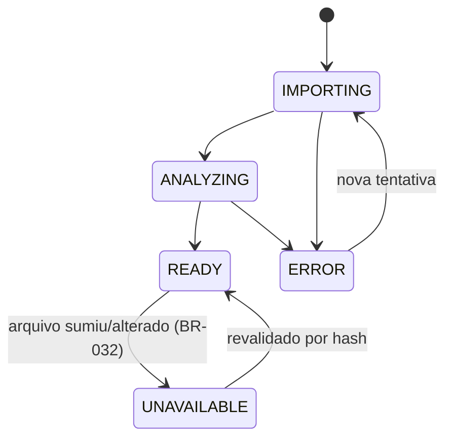
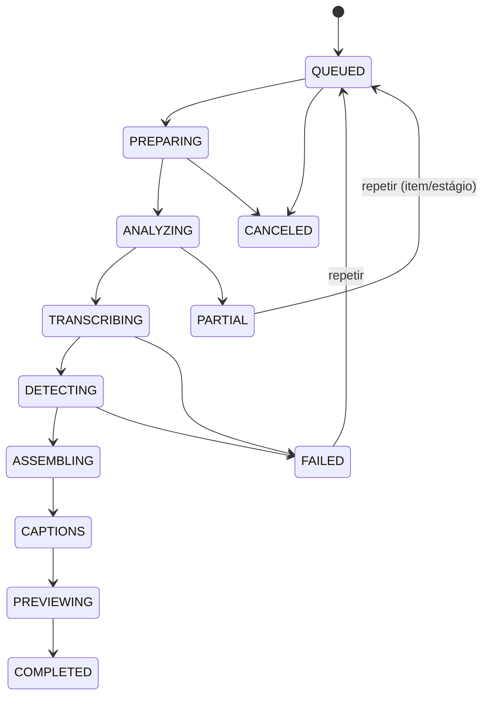
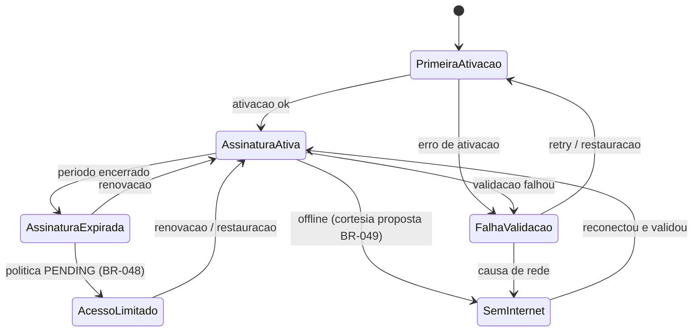

# CutNicePro — Business Rules + Estados e Transições

> BR-001..BR-050 e extensões de implementação identificadas ao final. Estado de cada regra: APPROVED (decisão do mantenedor registrada) /
> PROPOSED (proposta desta fase) / PENDING VALIDATION / PENDING TECHNICAL VALIDATION
> (depende de engenharia). Sem limites numéricos inventados.

## Projetos

- **BR-001 O projeto é o contêiner de trabalho** — mídias, cortes, configurações e
  exportações pertencem a um projeto. Motivação: continuidade (JRN-002/003/011).
  Estado: PROPOSED.
- **BR-002 Persistência local imediata** — toda decisão do usuário é persistida no
  armazenamento local do projeto sem ação explícita de "salvar projeto" (NFR-003).
  Exceção: edições dentro do editor avançado seguem BR-022. Estado: PROPOSED.
- **BR-003 Duplicação cria projeto independente** — cópia de configurações e registros,
  sem afetar o original (FR-017). Estado: PROPOSED (V1).
- **BR-004 Reabertura restaura o último estado** — seleção, filtros e job em andamento
  são restaurados conforme JRN-002. Estado: PROPOSED.
- **BR-005 Exclusão exige confirmação explícita e não apaga arquivos exportados** — o
  projeto some da biblioteca; exports em disco permanecem. Estado: PROPOSED.
- **BR-006 Armazenamento da origem** — implementação atual M2A: cópia gerenciada em app-data, hash SHA-256 e referências explícitas por projeto, com deduplicação. A proposta inicial de guardar somente caminho/hash não foi o caminho implementado; é registro histórico de trade-off, não instrução vigente. Distribuição, espaço e recuperação seguem validação por capacidade; não altera/apaga a origem do usuário. Implementação em revisão, sem aprovação global de todas as regras.

## Importação

- **BR-007 Formatos aceitos** — lista de contêineres/codecs suportados a definir pela
  engenharia; recusa vem com causa e alternativa. PENDING TECHNICAL VALIDATION.
- **BR-008 Duplicata identificada** — mesma mídia reimportada é sinalizada (caminho/hash),
  não duplicada silenciosamente. Estado: PROPOSED.
- **BR-009 Sem áudio ⇒ modo B indisponível com explicação** — cortes inteligentes exigem
  análise de fala; mídia muda pode seguir para modos A?/C — A também depende de fala ⇒ A e B
  bloqueados, C permitido. Estado: PROPOSED.
- **BR-010 Falha por item não aborta o lote** — itens válidos concluem; falhas listadas
  com causa. Estado: PROPOSED.
- **BR-011 Cancelamento preserva o concluído** — itens já importados permanecem.
  Estado: PROPOSED.

## Processamento

- **BR-012 Modos de processamento** — A (cortes inteligentes), B (legendas automáticas),
  C (ajuste manual); escolha reversível. Estado: PROPOSED (C = Should).
- **BR-013 Estágios declarados por modo** — o pipeline executa apenas estágios aplicáveis
  (ex.: modo B pula DETECTING/ASSEMBLING). Estado: PROPOSED.
- **BR-014 Fila por projeto: um job ativo por vez** — evita contenção de recursos locais;
  próximos jobs ficam QUEUED. PENDING TECHNICAL VALIDATION (paralelização futura).
  Código atual: gate global exclusivo rejeita concorrência; não mantém fila persistente QUEUED por projeto. Requisito de fila permanece pendente.
- **BR-015 Cancelamento** — marca CANCELED; resultados parciais válidos são preservados e
  sinalizados; repetir um processamento é ação do usuário sem qualquer cobrança ou consumo
  de créditos pelo CutNicePro (BR-038). Estado: PROPOSED.
- **BR-016 Falha parcial** — estágios concluídos são entregues; falha registrada por
  estágio (NFR-004). Estado: PROPOSED.
- **BR-017 Recursos insuficientes** — o job não inicia; orientação objetiva (disco/memória)
  sem jargão. Estado: PROPOSED.
- **BR-018 Retomada** — retomar job interrompido quando tecnicamente viável; caso
  contrário, reprocessamento com uma ação. PENDING TECHNICAL VALIDATION.
  ASR já reaproveita checkpoints validados por mídia/modelo/configuração; não equivale a retomar automaticamente geração, render ou qualquer job após reinício.

## Cortes

Complemento de implementação autorizado em 2026-10-24 (BR-019/020/023, FR-010/013/014): novas sugestões devem ter abertura autônoma e conclusão dentro do intervalo. Quantidade e duração são tetos; nota alta não anula a recusa explícita por contexto/conclusão. A análise final não publica sugestão nova com Gancho ou Fechamento abaixo do piso editorial existente de 50; falha de análise continua identificada, sem nota falsa. Se cenas/bordas alterarem o intervalo, a avaliação anterior não é reutilizada como prova de completude. Frases podem atravessar várias linhas do ASR; perguntas retóricas respondidas não são automaticamente o próximo assunto.

Pedido posterior do mantenedor em 2026-10-24, vigente para BR-019/020 e AC-041: Gerar cortes sempre executa novamente sobre o vídeo completo, mesmo quando os mesmos intervalos já estão na biblioteca, foram aprovados, rejeitados ou excluídos. Cada nova execução pode publicar outra versão do mesmo intervalo com ID próprio e nova data de criação. Versões, revisões e edições anteriores permanecem vinculadas aos IDs anteriores; não são substituídas, reanalisadas ou reativadas. A regra anterior de impedir repetições entre execuções foi revogada. Deduplicação permanece somente entre propostas/tentativas da execução atual. Isso não obriga a fabricar cortes quando o modelo não consegue selecionar uma unidade válida.

Uma avaliação editorial fundamentada atende simultaneamente seleção, título, resumo e critérios do mesmo intervalo, sem uma segunda votação contraditória. A descoberta recebe a transcrição inteira; o texto avaliado inclui toda a fala real dentro dos limites do corte, sem usar uma continuação externa para justificar sua completude. A assinatura acompanha o texto efetivamente avaliado; mudança de borda invalida o resultado anterior. Reparos limitados não dispensam avaliação, evidências, piso editorial ou teto por rodada.

Decisão expressa do mantenedor em 2026-10-25 (BR-019/020/023, FR-010, AC-041): o teto por execução é 16, automático e personalizado; a biblioteca acumulada não recebe teto total. Versões com intervalos parcialmente sobrepostos ou contidos podem coexistir na mesma geração, inclusive sobre o mesmo assunto. Cada versão deve passar em sua própria avaliação de abertura/conclusão e fidelidade; sobreposição não é motivo de recusa. Somente identidade ou intervalo/formato idênticos são deduplicados dentro do job; diferenças inferiores a 1 ms são tratadas como o mesmo intervalo. Versões anteriores continuam preservadas entre execuções. O refinamento de uma versão não usa outra versão como limite temporal. Publicidade continua identificada e tem prioridade secundária. Isso não autoriza falas novas, fragmentação artificial, quantidade obrigatória, nem sobreposição/reordenação dos segmentos internos do EditPlan v1.

Detecção local de rostos é independente do modelo textual. Só cortes novos 9:16 em cover recebem enquadramento inicial por YuNet; a posição persistida é uma âncora estática, não identidade nem trajetória. Ambiguidade incompatível com esse crop recomenda quadro inteiro; ausência/falha preserva a escolha de enquadramento e é informada. Edição salva prevalece sobre automação. Não reprocessar cortes históricos nem executar detector ao rolar a biblioteca. Estado editorial/visual segue pendente de avaliação humana dos novos resultados.

Complemento solicitado pelo mantenedor em 2026-10-24 (BR-019/020, JRN-002/008): a biblioteca global apresenta seções verticais por projeto, identificadas pelo ID de origem; ordenar clipes não mistura projetos. Miniaturas são imagens, sem um player persistente por card. O badge Novo depende somente da criação registrada e dura menos de 60 minutos completos; abrir, assistir, editar ou reanalisar não o remove nem reinicia a hora. Novos cortes recebem a criação após seleção/análise, antes da gravação; datas antigas/legadas são preservadas e não são inventadas. Tempo relativo continua visível após a expiração. Critérios e estado de validação em BACKLOG e ENGINE-HANDOFF; aprovação visual/manual pendente.

- **BR-019 Identificação estável** — cada corte tem ID persistente vinculado à mídia de
  origem; referências não se quebram entre sessões. Estado: PROPOSED.
- **BR-020 Timestamps gerados são imutáveis** — editar in/out cria nova versão (BR-022);
  a sugestão original permanece rastreável. Estado: PROPOSED.
- **BR-021 Aprovação/rejeição explícitas** — só cortes aprovados (ou editados a partir de
  aprovados) entram na exportação padrão. Estado: PROPOSED.
- **BR-022 Versionamento por edição** — cada sessão de edição avançada gera versão do
  corte com histórico navegável e reversível. Estado: PROPOSED.
  Ajustes isolados por clipe já persistem no workspace, mas histórico navegável completo não foi implementado.
- **BR-023 Pontuação editorial estimada** — estimativa interna sem promessa de desempenho/viralização. Código atual: Qwen textual propõe/analisa trechos; análise agrega Gancho/Desenvolvimento/Fechamento em 40/30/30. A seleção inicial exclusivamente por densidade/cadência é histórica. Citação validada não comprova qualidade editorial. A UI usa nota /100; linguagem técnica/genericidade foram rejeitadas pelo mantenedor e precisam correção. Princípio sem promessa preservado; implementação e linguagem em revisão.

## Legendas

- **BR-024 Idioma** — detectado quando possível; confirmação do usuário quando ambíguo.
  Estado: PROPOSED.
- **BR-025 Edição manual sempre disponível** — qualquer legenda automática pode ser
  corrigida texto/tempo (confiança — ver PRD §1). Estado: PROPOSED.
- **BR-026 Estilos** — conjuntos de estilo (tipografia, posição, animação por palavra)
  aplicáveis por corte; animação por palavra é Should (FR-012). Estado: PROPOSED.
- **BR-027 Exportação de legendas** — embutida no vídeo ou arquivo separado (.srt),
  escolhível por exportação. Estado: PROPOSED.

## Exportação

- **BR-028 Formatos/qualidade** — combinações suportadas definidas pela engenharia
  (codecs locais). PENDING TECHNICAL VALIDATION.
- **BR-029 Nomenclatura e conflitos** — nome padrão derivável (projeto + corte + formato);
  nunca sobrescrever arquivo existente sem confirmação explícita. Estado: PROPOSED.
- **BR-030 Lote** — fila de exportação com progresso por item; falha por item não aborta
  o lote. Estado: PROPOSED.
- **BR-031 Normalização/limpeza de metadados** — opção técnica de exportação; nenhuma
  alegação de originalidade, burla de reconhecimento ou garantia de monetização.
  Estado: APPROVED (restrição do mantenedor, alinhada a NFR-007).

## Integridade

- **BR-032 Mídia removida/alterada** — projeto marca a mídia UNAVAILABLE e preserva cortes
  e configurações; ações dependentes ficam bloqueadas com diagnóstico; religar o arquivo
  no mesmo caminho revalida por hash. Estado: PROPOSED.
- **BR-033 Recuperação de estado** — ao reiniciar após falha, o app oferece o último estado
  consistente; nada é reconstruído "por baixo" sem informar. Estado: PROPOSED.
- **BR-034 Operações interrompidas** — arquivos temporários/parciais de jobs abortados são
  gerenciados (limpos ou reaproveitados) sem deixar o projeto inconsistente.
  PENDING TECHNICAL VALIDATION.

## Direitos e conteúdo

- **BR-035 Responsabilidade de direitos** — o produto não verifica titularidade da mídia;
  o usuário declara-se responsável pelo direito de uso (comunicado no primeiro uso).
  Estado: PROPOSED.
- **BR-036 Separação técnica × plataforma** — exportar é ato técnico; elegibilidade de
  monetização/reconhecimento em plataformas externas está fora do produto.
  Estado: APPROVED (restrição do mantenedor).

## Comercialização e acesso (Fase 02A.1 — DEC-010/011)

- **BR-037 Acesso por assinatura mensal** — no produto comercial, o uso das funcionalidades
  contratadas requer assinatura ativa; estados comerciais mapeados em §Estados Comerciais.
  Mecanismo (conta/chave/dispositivo/validação periódica): PENDING USER DECISION (DEC-011).
  Estado: APPROVED (modelo) + PENDING USER DECISION (mecanismo).
- **BR-038 Ausência de créditos internos** — o CutNicePro não vende créditos e nada cobra
  por corte, transcrição ou exportação além da assinatura; nenhuma interface pode dar a
  impressão de compra de créditos. Estado: APPROVED (DEC-010).
- **BR-039 IA local é opção de primeira classe** — processamento local com modelos
  compatíveis instalados pelo usuário; descoberta, verificação de compatibilidade por
  tarefa e teste antes do uso. Requisitos de modelos/GPU: PENDING TECHNICAL VALIDATION;
  não exigir GPU dedicada quando houver alternativa viável. Estado: PROPOSED.
- **BR-040 BYOK é opção de primeira classe** — conexão de API própria (provedor + chave do
  usuário), com validação de credenciais, consulta de modelos quando suportada e informação
  prévia de custos externos do provedor. Estado: PROPOSED.
- **BR-041 Custos externos são do usuário** — provedores de API podem cobrar pelo consumo;
  a interface diferencia custo externo (provedor) de custo interno (nenhum, BR-038).
  Estado: APPROVED (DEC-010).
- **BR-042 Validação de modelos** — cada motor declarado deve ser validado por tarefa
  (fala/legendas/seleção/visual/reframe/render) antes de habilitar modos que dependam
  dela; um modelo pode ser apto a algumas tarefas e não a outras (matriz no PRD §13).
  Estado: PROPOSED; compatibilidade PENDING TECHNICAL VALIDATION.
- **BR-043 Privacidade e transparência do processamento** — a interface sempre sinaliza
  se a tarefa executa LOCAL ou EXTERNO; mídia/transcrições/imagens só vão a provedores
  externos com informação adequada e autorização do usuário. Estado: PROPOSED.
- **BR-044 Proteção de credenciais** — chaves de API jamais em logs, arquivos de projeto
  ou repositório; armazenamento seguro no Windows a definir na arquitetura técnica
  (PENDING TECHNICAL VALIDATION). Estado: PROPOSED (obrigação permanente de segurança).
- **BR-045 Falha de configuração de motor** — API inválida, limite externo atingido,
  modelo ausente/incompatível ou hardware insuficiente bloqueiam a tarefa dependente com
  causa e ação; nada de ficar preso sem alternativa quando houver uma viável.
  Estado: PROPOSED.
- **BR-046 Troca de motor não quebra projetos** — a configuração de IA é global/preferência
  trocável; projetos e cortes existentes permanecem íntegros; reprocessamento é opcional
  explícito. Estado: PROPOSED.
- **BR-047 Fallback silencioso proibido** — nunca trocar automática e silenciosamente de
  local para API paga (ou vice-versa); qualquer mudança de motor durante uso é explícita.
  Estado: PROPOSED.
- **BR-048 Expiração/renovação sem perda silenciosa** — mudança no estado da assinatura
  nunca apaga nem bloquea o acesso silencioso aos projetos do usuário. Política exata de
  acesso/exportação pós-expiração: PENDING USER DECISION (proposta em §Estados Comerciais).
  Estado: APPROVED (princípio) + PENDING USER DECISION (política detalhada).
- **BR-049 Comportamento offline proposto** — proposta: período de cortesia com validação
  periódica tolerante a ausência de internet, mantendo acesso local às funcionalidades
  já liberadas; detalhes (duração, o que fica disponível) PENDING USER DECISION.
  Fase 03 (2026-10-18): processamento local offline PERMITIDO quando tecnicamente
  viável (não bloqueia desenvolvimento); política comercial segue PENDING; projetos
  nunca são apagados por falha de conexão (reafirmado).
  Estado: PROPOSED.
- **BR-050 GLM Coding Plan não é API de produção** — planos de assistentes de código não
  se qualificam como provedor BYOK do produto. Estado: APPROVED (restrição do mantenedor).

---

## Estados e transições

### Aplicativo
`BOOT → READY → CLOSED` (falha em BOOT → READY com diagnóstico ou encerramento assistido).

### Projeto
`EMPTY → IMPORTED → CONFIGURED → PROCESSING ⇄ READY` (PROCESSING quando há job ativo;
ERROR de mídia não muda o estado do projeto — a mídia é que fica UNAVAILABLE).

### Mídia

### Job de processamento (modo A completo; B pula estágios conforme BR-013)

(Transição de cancelamento é permitida de qualquer estado ativo → CANCELED, BR-015.)

### Corte
`SUGGESTED → APPROVED → EDITING → EDITED → EXPORTED` com `SUGGESTED → REJECTED`
(rejeição reversível por decisão explícita; EXPORTED marca a última exportação bem-sucedida,
não um estado final exclusivo — reexportação permitida).

### Exportação
`QUEUED → RENDERING → COMPLETED | FAILED | CANCELED` (falha por item não aborta o lote, BR-030).

**Regra anti-contradição:** nenhum corte pode ser `EXPORTED` sem job de exportação
`COMPLETED` que o referencie; nenhum job `COMPLETED` sem prévias geradas para seus cortes.

### Estados comerciais (assinatura — DEC-010/011)

- Significados: `PrimeiraAtivacao` — primeira licença/conta configurada; `AssinaturaAtiva`
  — acesso pleno às funcionalidades contratadas; `AssinaturaExpirada` — período encerrado,
  projetos preservados; `AcessoLimitado` — política de acesso/visualização/exportação
  pós-expiração PENDING USER DECISION; `FalhaValidacao` — erro com causa e retry;
  `SemInternet` — comportamento offline PROPOSTO (BR-049).
- Em NENHUM estado os projetos do usuário são apagados ou bloqueados silenciosamente (BR-048).

## Extensão de implementação 03M — IN REVIEW, 2026-10-19

BR-03M-01..05 refinam BR-019..023/026..031 sem renumerar as 50 regras canônicas: abertura somente de leitura; revisão confirmada e reversível sem excluir mídia compartilhada; falha de análise individual identificada sem nota falsa; retomada por blocos validados sem substituir resultado publicado após falha; processamento exclusivo com fallback sequencial e saída verificada. Texto completo e AC-03M-01..08: docs/engineering/CLIP-PIPELINE-RELIABILITY-SPEC.md. Evidências funcionais no REVIEW correspondente não substituem aprovação do mantenedor.

## Extensão aprovada — editor básico completo (2026-10-26)

Vínculo: JRN-003/004/007/008/009/010; plano EDITOR-BASIC-IMPLEMENTATION-PLAN. Regras aprovadas pelo mantenedor, implementação em andamento.

- BR-EDITOR-01: o editor altera um rascunho; somente Salvar confirma a montagem. Recuperação é separada e nunca substitui o salvo silenciosamente.
- BR-EDITOR-02: tempo da fonte e tempo da montagem são independentes. Repetição, reordenação, múltiplas mídias e montagem vazia são válidas; original preservado.
- Seleção da fonte, refinamento autorizado em 2026-10-27: arrastar nas miniaturas marca um intervalo do original; Enter ou Adicionar confirma em nova camada no destino indicado, sem ripple, seek da montagem ou autosave. Mínimo de um frame; cancelar um gesto restaura as marcas anteriores. Confirmações repetidas por tecla pressionada/IME não podem criar cópias. O foco e os atalhos pertencem ao visualizador aberto. Adição rápida da biblioteca mantém o comportamento anterior.
- Refinamento de BR-EDITOR-02 pelo feedback de 2026-10-26: áudio original permanece integrado ao vídeo por padrão; extração ou áudio adicional são explícitos. Biblioteca e propriedades podem expandir/recolher, com uma única prévia central alternando Fonte/Montagem; comandos do projeto não ocupam a transcrição. Uma mídia em espera congela reprodução conjunta e relógio, sem avanço silencioso.
- Refinamento dos controles de faixa após teste manual: ocultar a imagem não desfaz a apresentação vinculada de áudio/CC nem silencia o som. Silenciar a faixa visual afeta somente áudio inequivocamente vinculado aos seus vídeos na prévia e exportação, sem apagar volume/mute individual ou afetar áudio independente. Bloqueio não equivale a mute; Salvar confirma os estados e Undo/Redo permanece disponível. Materiais independentes/ambíguos e estados próprios de faixas legadas preservam seus controles explícitos.
- BR-EDITOR-03: remover na faixa principal fecha espaço por padrão e remapeia elementos associados; manter espaço/fixar no tempo são opções explícitas. Faixas bloqueadas impedem operações que as alterem.
- Adição nas extremidades,2026-10-26: os botões+ da principal usam o menu existente com intenção por operação, sem deslocar o cursor. Início=0; fim=último item da principal, independentemente de caudas/overlays. Intenção acompanha importação/Fonte, não vaza após cancelamento/fechamento/troca de mídia, e não altera o formato salvo.
- Refinamento de BR-EDITOR-03 pelo feedback posterior de 2026-10-26: ímã desligado permite posicionar com lacunas; ligado reordena blocos sem fabricar partes. Aparar a esquerda mantém o fim fixo, exceto recuperar fonte anterior na origem zero. Ctrl+D/ Ctrl+V sobrepõem em camada acima; colagem em sequência é explícita (Ctrl+Shift+V). Arrasto entre faixas move identidades existentes e confirma uma ação; colisões não enfraquecem a proibição de sobreposição na mesma faixa.
- Correção do teste manual seguinte: religar o ímã reencaixa a principal em zero no rascunho, com Undo/Save explícitos; Ctrl+roda usa zoom local e largura não pode escapar do editor. Legendas da fonte têm indicação CC no vídeo, sem apagar os itens salvos. Clique simples isola a camada; Ctrl/Shift continuam permitindo seleção múltipla. Q/W aparam apenas os visuais selecionados e vínculos, sem remover outras camadas.
- Correção do acúmulo de camadas: excluir/aparar remove auxiliares desbloqueadas esvaziadas pela operação, preservando a principal e faixas com conteúdo restante. Movimento usa estrutura intermediária sem poda; Undo/Redo restaura identidades. Faixas vazias legadas não são apagadas ao abrir: a apresentação pode omitir auxiliares desbloqueadas sem qualquer item, mantendo bloqueadas e foco acessível. Régua/cursor devem continuar usáveis ao rolar muitas camadas; a posição visual não altera o tempo do cursor.
- Refinamento do cursor pelo mantenedor: aparar ou mover o objeto pausa a reprodução e preserva a posição editorial do cursor, sem seek para a borda ou início do item. Encurtar a montagem antes do cursor não altera silenciosamente sua posição nem aumenta a duração salva/exportável. No editor, a posição pausada pode ficar depois do novo fim; reproduzir a partir daí reinicia em zero. Inspeções da biblioteca mantêm o contrato limitado ao intervalo. Durante um gesto provisório, comandos da montagem não alteram seleção ou reprodução; Escape cancela e, após soltar/cancelar, Espaço volta a reproduzir/pausar com foco na timeline. Campos de texto, Fonte, menus e modais preservam seu comportamento.
- Refinamento do trim magnético após perda de camadas: aparar altera somente o grupo-alvo. Reencaixe pelo ímã desloca apenas os blocos posteriores da principal e seus acompanhantes por grupo explícito; atravessar o intervalo no tempo não torna outra camada vinculada. Vídeos, imagens, áudio e CC independentes mantêm IDs, fontes, duração, propriedades e faixas, inclusive quando `followsMain=true`. Não usar remoção/inserção global de intervalo para implementar esse trim. Locks do que realmente muda impedem o comando inteiro sem mutação; locks independentes não o impedem. Bloco posterior fixado na principal tem precedência: nesta fatia o ripple é recusado com orientação para desligar o ímã, sem algoritmo novo de compactação ao redor de fixos.
- BR-EDITOR-04: salvar edição de corte da IA mantém o ID e projeto, identifica edição manual e retira a nota corrente. Criar clipe manual salva somente o novo clipe, sem confirmar a montagem do projeto.
- Refinamento de BR-EDITOR-04,2026-10-26: confirmação de novo clipe oferece Ir para clipes sem navegação automática; rascunho pendente exige decisão de saída e falha de salvamento mantém o editor. Card editado usa tag Editado no espaço da nota; título limitado a duas linhas, reticências e tooltip completo do projeto, com nomes acessíveis. Recorte sem vídeo/imagem não publica novo clipe nem modifica os vínculos de mídia; salvar uma montagem vazia continua permitido.
- BR-EDITOR-05: importação e ASR precedem a visão geral; falha/cancelamento de ASR preserva mídia e permite edição manual. IA continua usando a fonte original; correções de legenda do clipe são locais.
- Refinamento de BR-EDITOR-02/05, 2026-10-26: legendas vinculadas pertencem à camada visual da sua ocorrência e respeitam sua posição, escala, opacidade e oclusão. A seleção define somente o contexto da Transcrição/propriedades; cada clique usa o tempo de saída da ocorrência e a correção não altera outra cópia ou a ASR original. Legendas independentes permanecem explícitas; bloquear não desfaz o vínculo de renderização.
- BR-EDITOR-06: exportação usa uma revisão salva imutável; falha/cancelamento não publica parcial nem apaga saída anterior. Novo dura uma hora desde a criação ou o último salvamento de edição manual, independentemente de abertura. A edição atualiza o tempo mostrado e a ordenação recente sem substituir a data original de criação; excluir/restaurar e reanalisar não renovam a data de edição.
- BR-EDITOR-07, direção adicional M7 (2026-10-26): novas mídias podem ser referenciadas no original externo, sem cópia integral. A primeira fatia mantém SHA integral verdadeiro, cancelamento e validação antes do uso; não promete reconhecimento instantâneo. Propriedade managed/reference é explícita e entradas antigas continuam gerenciadas. Excluir projeto ou limpar cache nunca remove um original externo, e exportação não o sobrescreve. Fonte movida exige localização e confirmação do mesmo conteúdo; fonte alterada fica indisponível, preservando documento/ASR/edições anteriores em vez de aplicá-los silenciosamente a outros bytes. M7A implementado e coberto por contratos/fixtures e exportação FFmpeg real; sem aceite da jornada normal ou inferência ASR deduzido desses testes.

- BR-EDITOR-08, biblioteca e lixeira2026-10-26: Ativos significa não excluídos, incluindo os antigos rejeitados; os únicos filtros atuais são Ativos, Todos e Lixeira. Aprovação histórica permanece compatível no armazenamento, sem esconder conteúdo nem expor um fluxo de aprovação removido. A exclusão recuperável grava a data nativa e permite restaurar durante7dias; depois há remoção definitiva dos registros e derivados exclusivos. Exclusões antigas sem data recebem um novo prazo persistido na primeira migração, sem inferir a data pela criação. Exclusão permanente explícita exige confirmação e estado excluído. Mídias originais, exports e caches compartilhados são preservados. Os dois registros IA/editor e recuperações não podem ressuscitar o ID removido por gravação tardia. Limpeza ocorre ao abrir/retornar à biblioteca e durante uso ativo, suspensa durante editor/job; não existe serviço de limpeza com o app fechado.
- Refinamento de BR-EDITOR-02/05,2026-10-26: Importar mídia na biblioteca apenas registra o asset; inserir na montagem é ação separada. Arraste interno usa o ponto e a faixa de destino; arquivo do Windows sobre a biblioteca importa, sobre a timeline importa e insere após revalidar destino/locks. Cancelamento ou destino inválido preserva a montagem e não move o cursor. Os botões+ de início/fim mantêm seu contrato. Miniatura de imagem usa a URL resolvida sem passar pelo gerador de miniaturas de vídeo; um marcador de trecho curto pode ampliar a escala para editar, sem alterar duração/posição reais.
